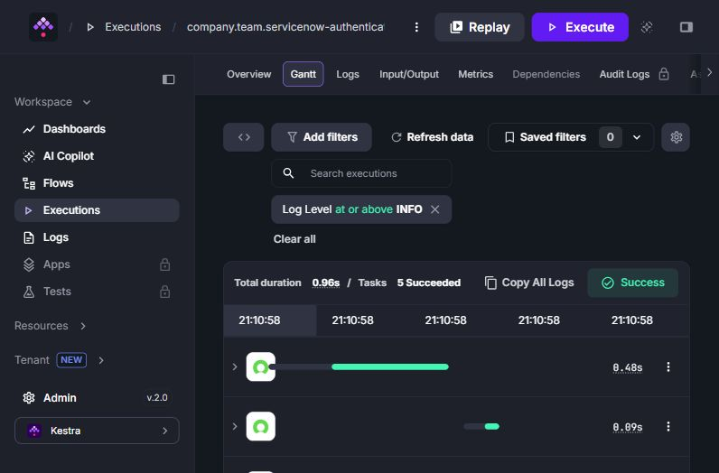

# ServiceNow #108 QA

This branch carries review evidence only. The PR branch is `fix/stateless-authentication-108`; its diff contains only the shared authentication fix and regression tests.

## Regression evidence

Base: `3b001214dc98b2d030cbade2457b04644b73073e` (upstream main).
Fix: `306fbba51d6e067475b2ea47ab2b1af3b0173562`.
Java 21, Gradle wrapper 9.8.0, default `kestraVersion=1.3.39`.

| AuthenticationTest | Base | Fix |
| --- | --- | --- |
| Repeated execution after token expiry | Failed: cached token rejected | Passed |
| Changed rendered OAuth credentials | Failed: Bob received Alice's result | Passed |
| Overlapping executions | Failed: Bob received Alice's result | Passed |
| Basic Auth with no configured options | Failed: task options changed | Passed |
| Basic Auth with existing options | Failed: task options replaced | Passed |

`./gradlew test` passes all 18 tests with no skips on the fix. `shadowJar` builds. Spotless checks pass for both changed files; the repository-wide formatting check reports existing violations in untouched Delete/Get/Post/Update/GetTest sources.

To reproduce the baseline, create a separate checkout at the base commit, copy `AuthenticationTest.java` from the PR branch into the same test package, and run:

```sh
./gradlew test --tests io.kestra.plugin.servicenow.AuthenticationTest
```

The same command passes on the PR branch.

## Kestra runtime smoke

- Kestra `kestra/kestra:v2.0.6-no-plugins`, with the PR's shaded JAR in `/app/plugins`.
- JAR SHA256: `46a2ab475d417ea223f2b87b90ba85c14f236468dba81e374df1d01f7488af7a`.
- Execution: `1lCQkdl8M3ryzJdRJg4lwp`, SUCCESS, 5/5 tasks.
- `Get` as Alice through OAuth; `Post`, `Update`, `Delete` as Bob through OAuth; `Get` as Bob through Basic Auth.
- API output assertions: `oauth_owner=alice`, `created_owner=bob`, `updated_owner=bob`, `basic_owner=bob`, `deleted=true`.

Run `python mock.py` on the Docker host, import `flow.yaml`, and execute it. The credentials in the flow are disposable fixtures accepted only by the mock. The mock implements the authentication and record endpoints used by the flow; it is not a ServiceNow instance. No real ServiceNow tenant was tested.

The runtime smoke verifies plugin loading and HTTP behavior through all four task types. It is not the instance-reuse regression reproduction; `AuthenticationTest` provides that evidence.


